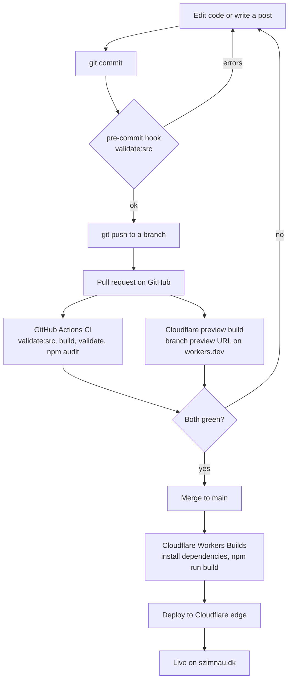
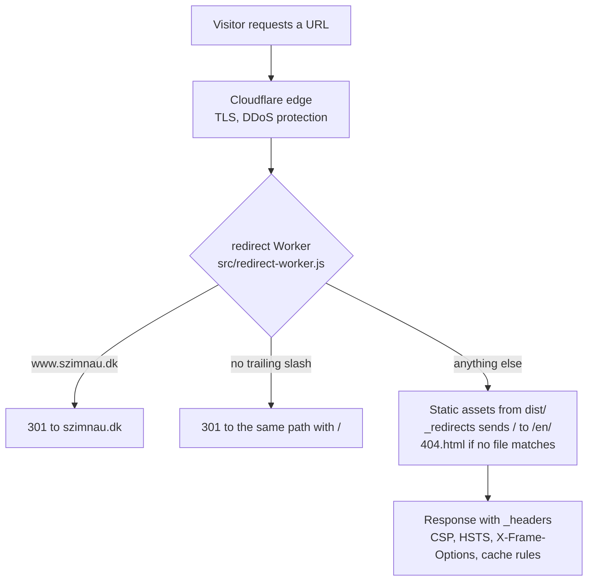

# szimnau.dk

Source for [szimnau.dk](https://szimnau.dk), a blog about Home Assistant and home automation in English, Danish and German. It is a static Astro 7 site that Cloudflare builds and serves on every push to `main`. Development rules for people and Claude Code are in `CLAUDE.md`.

## Stack

| Layer | Tool | Notes |
| --- | --- | --- |
| Framework | [Astro 7](https://astro.build) | `output: 'static'`. Every page is plain HTML at build time. No server code runs per request apart from the redirect Worker |
| Styling | [Tailwind CSS 4](https://tailwindcss.com) | Via `@tailwindcss/vite`. Design tokens in `src/styles/global.css` under `@theme {}` |
| Content | MDX with Astro content collections | Posts in `src/content/blog/{en,da,de}/`, schema in `src/content.config.ts`. Markdown runs on Sätteri, the Astro 7 default |
| Code highlighting | Shiki | Built into Astro. Use `jinja`, never `jinja2` |
| Search | [Pagefind](https://pagefind.app) | Indexes `dist/` after the build. Runs in the browser, no search server |
| Fonts | Fontsource | Inter, Plus Jakarta Sans and JetBrains Mono, self-hosted. No calls to Google Fonts |
| Icons | Phosphor | SVGs read from `@phosphor-icons/core` at build time |
| SEO | `@astrojs/sitemap`, `SEO.astro` | Sitemap, hreflang, JSON-LD, generated `/llms.txt` and RSS feeds per language |
| Runtime | Node 24 | Pinned in `.node-version`. Astro 7 needs `>=22.23.4` |
| Hosting | Cloudflare Workers | Static assets plus a small redirect Worker. See below |
| Domain and DNS | Cloudflare Registrar and DNS | Same Cloudflare account as hosting |
| Analytics | Cloudflare Web Analytics | No cookies. Described on the privacy page |
| CI | GitHub Actions and Dependabot | `.github/workflows/ci.yml`, `.github/dependabot.yml` |

## How a change goes live



Dependabot opens pull requests for npm packages (weekly) and GitHub Actions (monthly). They go through the same CI and preview build. CI also runs every Monday on `main`, so date-based checks such as the `security.txt` expiry fail even when nobody pushes.

### What `npm run build` does

1. Deletes `dist/`.
2. `astro build` renders every page in all three languages to static HTML in `dist/` and copies `public/` into it.
3. `pagefind --site dist` builds the search index in `dist/pagefind/`.
4. `node scripts/build-csp.mjs` hashes every inline script in the built HTML and writes a `Content-Security-Policy` into `dist/_headers`.

Cloudflare runs the same command, so a local build matches production.

## How a request is served



`wrangler.toml` connects the pieces:

- `main = "src/redirect-worker.js"` with `run_worker_first = true`. The Worker sees every request first. It issues permanent 301 redirects for `www` and missing trailing slashes, because Cloudflare's own normalization uses 307, which Google Search Console treats as unstable. Everything else goes to the static assets.
- `[assets] directory = "./dist"` serves the build output. `public/_headers` and `public/_redirects` are copied into `dist/` and applied by Cloudflare.
- `not_found_handling = "404-page"` serves `dist/404.html` for unknown paths.

Every pull request also gets a preview deployment on `workers.dev`. Cloudflare posts its URL as a comment on the pull request.

## Repository layout

```text
.claude/            Claude Code skills, settings and the cloud session hook
.githooks/          pre-commit hook (runs validate:src)
.github/            CI workflow and Dependabot config
public/             copied as-is into dist/: _headers, _redirects, robots.txt,
                    ai.txt, security.txt, images, favicons
scripts/
  build-csp.mjs     writes the CSP into dist/_headers after the build
  validate.mjs      source and SEO checks (see Quality gates)
  lint-da.mjs       Danish language check for posts (npm run lint:da)
src/
  components/       Header, Footer, SEO, BlogCard, HardwareLab and others
  content/blog/     posts in en/, da/ and de/
  i18n/             UI strings, locale helpers, RSS and automation data
  layouts/          Base.astro and BlogPost.astro
  pages/            one folder per language, plus 404, llms.txt and rss.xml
  redirect-worker.js  the Cloudflare Worker
  styles/global.css Tailwind import, fonts and design tokens
astro.config.mjs    site URL, i18n, sitemap, Markdown and whitespace settings
wrangler.toml       Cloudflare Worker and static assets config
```

All routes are prefixed with the language (`/en/`, `/da/`, `/de/`). Every page exists in all three languages. Danish and German are written from scratch, not translated.

## Quality gates

| Check | Where it runs | What it enforces |
| --- | --- | --- |
| `npm run validate:src` | pre-commit hook and CI | Required frontmatter, `translationKey` in all three languages, every referenced image exists and is tracked in git, `security.txt` not expiring within 30 days, voice warnings |
| `npm run build` | CI and Cloudflare | The site builds with 0 errors |
| `npm run validate` | CI | On every built page: title format, description length and uniqueness, canonical, hreflang, Open Graph tags, one h1, heading order, hero image attributes |
| `npm audit --omit=dev --audit-level=high` | CI | No high or critical advisories in runtime dependencies |

## Security

- **Static output.** There is no database, login, form handler or server runtime to attack. The only code that runs per request is the redirect Worker.
- **Headers.** `public/_headers` sets HSTS (with preload), `X-Frame-Options: DENY`, `X-Content-Type-Options`, `Referrer-Policy` and `Permissions-Policy`. The build adds a Content-Security-Policy with SHA-256 hashes for inline scripts and no `unsafe-inline` for scripts. A new external script, font, image host or `fetch` target must be added in `scripts/build-csp.mjs`, or the browser blocks it.
- **Disclosure.** `public/.well-known/security.txt` (RFC 9116) gives a contact address. It expires after one year and CI fails 30 days before that.
- **Dependencies.** Dependabot keeps packages current. CI blocks high and critical advisories.

## Set up on a new machine

1. Install Git and fnm (a Node version manager that reads `.node-version`).

   ```powershell
   winget install --id Git.Git -e
   winget install --id Schniz.fnm -e
   # Add to your PowerShell profile so it loads in every session:
   fnm env --use-on-cd --shell powershell | Out-String | Invoke-Expression
   ```

2. Clone, install the pinned Node version and build.

   ```powershell
   git clone https://github.com/RolfSzimnau/szimnau-dk.git
   cd szimnau-dk
   fnm install         # installs the version in .node-version (24)
   fnm use
   node -v             # must be v24.x
   npm ci              # also enables the pre-commit hook in .githooks/
   npm run build
   npm run validate    # must report 0 fejl
   npm run dev         # http://localhost:4321/en/
   ```

3. Optional: install Claude Code. `CLAUDE.md`, the skills in `.claude/skills/` and the session hook come with the repo. In Claude Code cloud sessions, the hook installs Node 24 and the dependencies on its own.

No `.env` file or secrets are needed to build the site.

## What lives outside this repo

The code is complete in git. These settings are not, so check them after any account or project change and keep this list current.

| Where | Setting | Value |
| --- | --- | --- |
| Cloudflare, Workers project `szimnau-dk` | Git connection | `RolfSzimnau/szimnau-dk`, production branch `main` |
| | Build command | `npm run build` (without it, pagefind and the CSP are skipped) |
| | Build variables | none. Do not set `NODE_VERSION` (`.node-version` decides) |
| | Custom domains | `szimnau.dk` and `www.szimnau.dk` (the Worker redirects www to the apex) |
| | Web Analytics | on (allowed in the CSP) |
| Cloudflare, zone `szimnau.dk` | DNS records | export with **DNS > Records > Export** and store a copy outside this machine |
| | Mail DNS | SPF, DKIM and DMARC records for the mail provider |
| Cloudflare Registrar | Domain `szimnau.dk` | **Manage Domains**: auto-renew on, valid payment card, registrar lock on. Nameservers are always Cloudflare |
| GitHub | Repository settings | Dependabot on, Actions enabled, branch protection on `main` if set |

## Accounts and recovery

Losing the machine is only a problem if it held the only way to sign in. The Cloudflare account holds the domain, DNS and hosting together, so losing access to it takes the whole site offline. For GitHub, Cloudflare and the mail account:

- Keep the recovery codes somewhere other than this machine, such as a password manager or a printed copy.
- Use passkeys that sync (password manager or phone) or a hardware key, not a passkey stored only on this machine.
- Make sure each account has at least two sign-in methods.

## Recurring tasks

- **security.txt:** renew `Expires` in `public/.well-known/security.txt` once a year. CI fails 30 days before it expires.
- **Dependabot PRs:** merge when CI is green. Read the release notes for major versions.

## Rollback

- **Bad deploy:** revert the commit on GitHub (`git revert <commit>` and push). Cloudflare deploys the previous state. A faster fallback is to roll back to an earlier version under **Deployments** in the Cloudflare project.
- **CSP blocks something:** add the host to `scripts/build-csp.mjs`, or remove `&& node scripts/build-csp.mjs` from the `build` script to drop the CSP entirely.

## Troubleshooting

- **Cloudflare build fails on Node:** Astro 7 needs Node `>=22.23.4`. Remove any `NODE_VERSION` build variable so `.node-version` (24) applies.
- **`npm run validate` fails on security.txt:** set `Expires` one year ahead.
- **Pre-commit hook blocks a commit:** fix what it reports, or skip it once with `git commit --no-verify`.
- **CSP header missing on the live site:** the Cloudflare build command is not `npm run build`.
